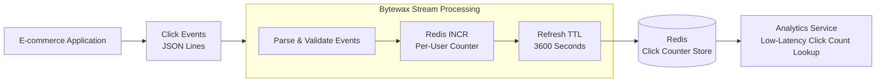

# Lab 4.6 — Streaming Click Analytics with Redis

**Level:** Intermediate | **Topic:** Streaming | **Tools:** Bytewax + Redis

## Introduction

At DataHive, an e-commerce platform receives thousands of product clicks every minute, and the analytics team needs to retrieve click counts for individual users without repeatedly scanning historical events. In this lab, you will build a streaming pipeline using Bytewax to process click events and Redis to maintain per-user counters with a one-hour time-to-live (TTL), enabling fast lookups while automatically expiring inactive counters.

## Project File Structure

Create the following project in VS Code Server.

```
datahive-click-analytics/
├── data/
│   └── clicks.jsonl
├── src/
│   └── streaming.py
└── requirements.txt
```

- `data/clicks.jsonl` — sample click events.
- `src/streaming.py` — Bytewax streaming pipeline and Redis counter updates.
- `requirements.txt` — Python dependencies.

## Architecture Diagram



## Chapter 1 — Prepare the Development Environment

Open the VS Code Server terminal and create the project directories.

```bash
mkdir -p datahive-click-analytics/{data,src}
cd datahive-click-analytics

python3 -m venv .venv
source .venv/bin/activate
python -m pip install --upgrade pip
```

The virtual environment isolates the lab's Python dependencies from system packages. The `data` directory stores click events, while `src` contains the streaming implementation. Run all subsequent project commands from the `datahive-click-analytics` directory.

## Chapter 2 — Start Redis

Start a Redis container using Docker.

```bash
docker run -d \
  --name datahive-redis \
  -p 127.0.0.1:6379:6379 \
  redis:7-alpine
```

Verify that Redis is responding.

```bash
docker exec datahive-redis redis-cli PING
```

Expected output:

```
PONG
```

Redis will store each user's click count as a key-value pair, such as `clicks:user_101`. Binding the port to localhost avoids exposing Redis on all host network interfaces. This setup is intended for a local lab; production deployments should use appropriate authentication, private networking, and access controls.

## Chapter 3 — Install Dependencies

Open `requirements.txt` in the VS Code Server editor and add:

```
bytewax
redis
```

Install the packages.

```bash
python -m pip install -r requirements.txt
python -m pip show bytewax redis
```

Bytewax provides the streaming dataflow engine, while the Redis Python client connects the pipeline to Redis. Installing both packages in the virtual environment keeps the lab's dependencies separate from the system Python installation. If installation fails, check that your Python version is supported by the Bytewax release being installed.

## Chapter 4 — Prepare Sample Click Events

Open `data/clicks.jsonl` in the VS Code Server editor and insert these records, one JSON object per line.

```json
{"event_id":"evt_001","user_id":"user_101","page":"/products/phone","event_type":"click"}
{"event_id":"evt_002","user_id":"user_202","page":"/products/laptop","event_type":"click"}
{"event_id":"evt_003","user_id":"user_101","page":"/products/shoes","event_type":"click"}
{"event_id":"evt_004","user_id":"user_101","page":"/products/watch","event_type":"click"}
{"event_id":"evt_005","user_id":"user_202","page":"/products/tablet","event_type":"click"}
{"event_id":"evt_006","user_id":"user_303","page":"/products/camera","event_type":"click"}
```

Each record represents a click event generated by the e-commerce application. The `user_id` field determines which Redis counter will be incremented, and `event_id` identifies the event. This file provides a reproducible test stream; a production pipeline could receive events from Kafka or another supported streaming source.

## Chapter 5 — Implement the Streaming Pipeline

Open `src/streaming.py` and add the following implementation.

```python
import json
import os

import redis
from bytewax.dataflow import Dataflow
from bytewax import operators as op
from bytewax.connectors.files import FileSource
from bytewax.connectors.stdio import StdOutSink

REDIS_URL = os.getenv(
    "REDIS_URL",
    "redis://127.0.0.1:6379/0",
)
TTL_SECONDS = 3600

client = redis.Redis.from_url(
    REDIS_URL,
    decode_responses=True,
    socket_connect_timeout=5,
)
client.ping()


def parse_event(raw_event):
    if isinstance(raw_event, bytes):
        raw_event = raw_event.decode("utf-8")

    event = json.loads(raw_event)

    if event.get("event_type") != "click":
        return None

    user_id = event.get("user_id")
    event_id = event.get("event_id")

    if not user_id or not event_id:
        raise ValueError(
            "Click event requires user_id and event_id"
        )

    return {
        "event_id": event_id,
        "user_id": user_id,
    }


def update_counter(event):
    if event is None:
        return None

    key = f"clicks:{event['user_id']}"

    # Increment the user's counter atomically.
    count = client.incr(key)

    # Refresh the one-hour expiry.
    client.expire(key, TTL_SECONDS)

    return {
        "user_id": event["user_id"],
        "click_count": count,
        "ttl_seconds": client.ttl(key),
    }


flow = Dataflow("datahive-click-analytics")

raw_events = op.input(
    "click_events",
    flow,
    FileSource("data/clicks.jsonl"),
)

parsed_events = op.map(
    "parse_click_events",
    raw_events,
    parse_event,
)

updated_counts = op.map(
    "update_redis_counters",
    parsed_events,
    update_counter,
)

op.output(
    "print_updated_counts",
    updated_counts,
    StdOutSink(),
)
```

The dataflow reads the JSON Lines file, validates each click event, and increments the corresponding user's Redis counter. Redis `INCR` performs the increment atomically, while `EXPIRE` refreshes the counter's one-hour TTL after each update. The standard output sink prints processed results for inspection. This basic implementation is intended for a single processing run and does not yet provide event deduplication or transactional guarantees across Redis and the streaming engine.

## Chapter 6 — Run the Pipeline

Confirm that Redis is running and the virtual environment is activated.

```bash
docker exec datahive-redis redis-cli PING
```

Run the pipeline from the project root.

```bash
python -m bytewax.run src.streaming:flow
```

For a fresh Redis instance, the final counts should be three clicks for `user_101`, two for `user_202`, and one for `user_303`. The terminal may display intermediate counts as events are processed. If you run the same file again without clearing the counters, the counts will increase again because this example does not deduplicate previously processed events.

## Chapter 7 — Verify Redis Counters and TTL

Use a second VS Code Server terminal to inspect the final counters.

```bash
docker exec datahive-redis redis-cli MGET \
  clicks:user_101 clicks:user_202 clicks:user_303
```

Expected output for a fresh Redis instance:

```
1) "3"
2) "2"
3) "1"
```

Check the remaining TTL.

```bash
docker exec datahive-redis redis-cli TTL clicks:user_101
```

Inspect the stored value and key existence.

```bash
docker exec datahive-redis redis-cli GET clicks:user_101
docker exec datahive-redis redis-cli EXISTS clicks:user_101
```

Redis stores the latest count for each user, allowing other services to retrieve it without scanning the event file. The TTL should initially be close to 3600 seconds and decrease over time until another click refreshes it. Once a counter expires, Redis removes that key automatically. These expected values assume the counters started at zero and the sample file was processed once.

## Chapter 8 — Clean Up

Stop and remove the Redis container after completing the verification.

```bash
docker stop datahive-redis
docker rm datahive-redis
```

When you no longer need the Python environment, deactivate it.

```bash
deactivate
```

Stopping and removing the Redis container ends the lab's Redis service. Unless persistence has been configured, container-local Redis data may not survive removal. Keep the project files for future testing, and avoid removing unrelated containers, images, or volumes from a shared development environment.

## Conclusion

In this lab, you built a streaming click analytics pipeline using Bytewax and Redis. The pipeline processes click events, maintains separate counters for individual users, and refreshes a one-hour TTL whenever a new click arrives. Redis enables low-latency access to current counts without repeatedly scanning historical events. The project provides a foundation for integrating a production event source and exposing real-time click analytics to other services.
