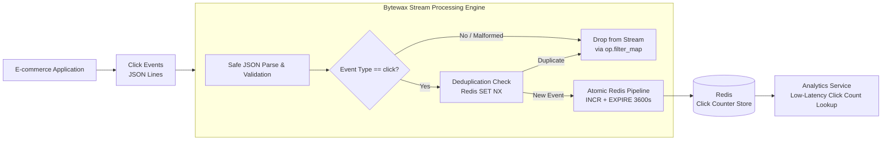
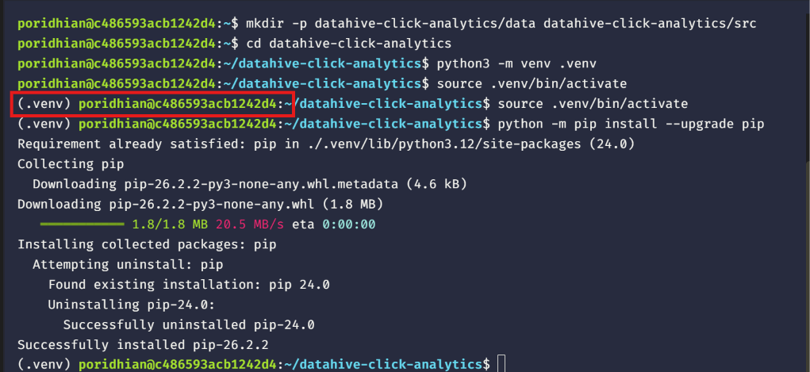
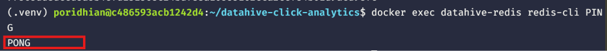
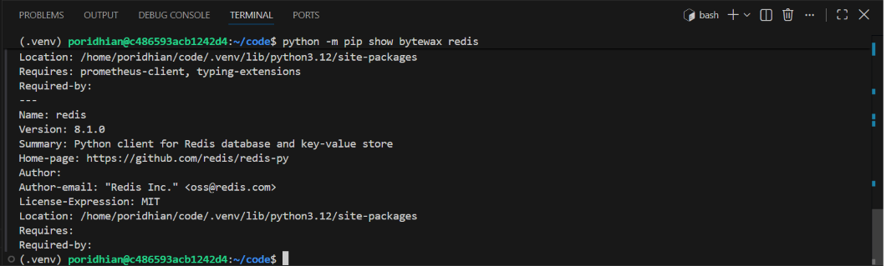
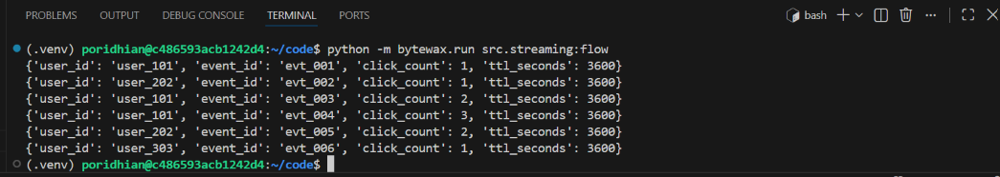
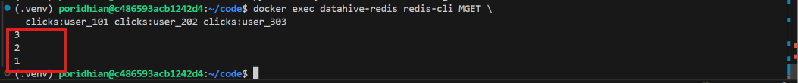
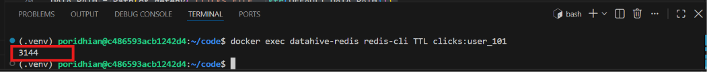
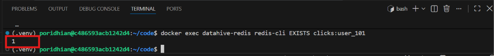
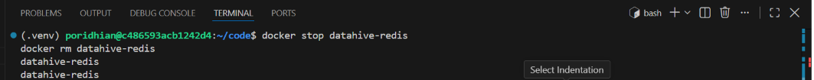

# Lab — Building a Real-Time Click Analytics Pipeline with Redis

**Level:** Intermediate 

## Introduction

At DataHive, an e-commerce platform receives thousands of product clicks every minute, and the analytics team needs to retrieve click counts for individual users without repeatedly scanning historical events. In this lab, you will build an end-to-end streaming pipeline using Bytewax to process click events and Redis to maintain per-user counters with a one-hour time-to-live (TTL). 

This improved implementation incorporates **atomic Redis pipelines (`MULTI/EXEC`)**, **event deduplication (idempotency)**, **graceful error handling for corrupted records**, and **stream filtering** with `op.filter_map`, ensuring accurate counts and preventing memory leaks from zombie keys.

## Project File Structure

Create the following project structure:

```
datahive-click-analytics/
├── data/
│   └── clicks.jsonl
├── src/
│   └── streaming.py
└── requirements.txt
```

- `data/clicks.jsonl` — sample click events.
- `src/streaming.py` — Bytewax streaming pipeline with atomic Redis counter updates and deduplication.
- `requirements.txt` — Python dependencies.

## Architecture Diagram



## Chapter 1 — Prepare the Development Environment

Open your terminal and create the project directories.

> **Note on Python Version:** Bytewax distributes pre-compiled wheels for **Python 3.10 through 3.12**. Ensure you are using Python 3.10, 3.11, or 3.12 so you do not need to install a Rust compiler toolchain.

### Linux / macOS / VS Code Server (Bash)

```bash
mkdir -p datahive-click-analytics/data datahive-click-analytics/src
cd datahive-click-analytics

python3 -m venv .venv
source .venv/bin/activate
python -m pip install --upgrade pip
```

### Windows (PowerShell)

```powershell
New-Item -ItemType Directory -Force -Path "datahive-click-analytics/data", "datahive-click-analytics/src"
cd datahive-click-analytics

python -m venv .venv
.\.venv\Scripts\Activate.ps1
python -m pip install --upgrade pip
```


The virtual environment isolates the lab's Python dependencies from system packages. Run all subsequent project commands from the `datahive-click-analytics` directory.

## Chapter 2 — Start Redis

Start a Redis container using Docker. The command removes any leftover container with the same name before starting a fresh container.

```bash
docker rm -f datahive-redis 2>/dev/null || true
docker run -d \
  --name datahive-redis \
  -p 127.0.0.1:6379:6379 \
  redis:7-alpine
```

Verify that Redis is responding:

```bash
docker exec datahive-redis redis-cli PING
```

Expected output:



Redis stores each user's click count as a key-value pair (`clicks:user_101`) and tracks processed event IDs (`clicks:dedup:evt_001`) with a 1-hour expiration. Binding to `127.0.0.1` avoids exposing Redis to external interfaces.

## Chapter 3 — Install Dependencies

Open `requirements.txt` and specify the dependencies:

```
bytewax>=0.21.0
redis>=5.0.0
```

Install the packages:

```bash
python -m pip install -r requirements.txt
python -m pip show bytewax redis
```


Bytewax provides the dataflow streaming engine, and `redis` provides the Python client with connection pooling and pipeline support.

## Chapter 4 — Prepare Sample Click Events

Open `data/clicks.jsonl` and insert the test records. This includes valid click events and a non-click event to test stream filtering:

```json
{"event_id":"evt_001","user_id":"user_101","page":"/products/phone","event_type":"click"}
{"event_id":"evt_002","user_id":"user_202","page":"/products/laptop","event_type":"click"}
{"event_id":"evt_003","user_id":"user_101","page":"/products/shoes","event_type":"click"}
{"event_id":"evt_004","user_id":"user_101","page":"/products/watch","event_type":"click"}
{"event_id":"evt_005","user_id":"user_202","page":"/products/tablet","event_type":"click"}
{"event_id":"evt_006","user_id":"user_303","page":"/products/camera","event_type":"click"}
{"event_id":"evt_007","user_id":"user_101","page":"/products/mouse","event_type":"view"}
```

Notice that `evt_007` is a `"view"` event, which the pipeline must safely filter out without emitting `None` to downstream sinks.

## Chapter 5 — Implement the Streaming Pipeline

Open `src/streaming.py` and add the corrected, production-grade streaming pipeline:

```python
import json
import os
import sys
from pathlib import Path

import redis
from bytewax import operators as op
from bytewax.connectors.files import FileSource
from bytewax.connectors.stdio import StdOutSink
from bytewax.dataflow import Dataflow

REDIS_URL = os.getenv(
    "REDIS_URL",
    "redis://127.0.0.1:6379/0",
)
TTL_SECONDS = int(os.getenv("COUNTER_TTL_SECONDS", "3600"))

# Robust path resolution relative to script location
DEFAULT_DATA_PATH = Path(__file__).resolve().parent.parent / "data" / "clicks.jsonl"
DATA_PATH = Path(os.getenv("CLICKS_FILE", str(DEFAULT_DATA_PATH)))

# Redis client initialization with connection pooling
client = redis.Redis.from_url(
    REDIS_URL,
    decode_responses=True,
    socket_connect_timeout=5,
)

# Non-blocking startup check
try:
    client.ping()
except redis.ConnectionError as err:
    sys.stderr.write(
        f"[WARNING] Could not connect to Redis at {REDIS_URL}: {err}\n"
        "Please ensure Redis is running before processing streaming events.\n"
    )


def parse_event(raw_event):
    """
    Safely parses JSON event records and filters for click events.
    Returns a validated dictionary, or None to drop the item from the stream.
    """
    if isinstance(raw_event, bytes):
        raw_event = raw_event.decode("utf-8")

    try:
        event = json.loads(raw_event)
    except (json.JSONDecodeError, TypeError, UnicodeDecodeError):
        # Drop malformed non-JSON lines without terminating the pipeline
        return None

    if not isinstance(event, dict):
        return None

    if event.get("event_type") != "click":
        return None

    user_id = event.get("user_id")
    event_id = event.get("event_id")

    if not user_id or not event_id:
        return None

    return {
        "event_id": str(event_id),
        "user_id": str(user_id),
        "page": event.get("page", ""),
    }


def update_counter(event):
    """
    Updates the user's click counter atomically in Redis.
    Performs event deduplication via SET NX and bundles INCR + EXPIRE
    in a single atomic transaction pipeline (MULTI/EXEC).
    """
    if not event:
        return None

    user_id = event["user_id"]
    event_id = event["event_id"]
    counter_key = f"clicks:{user_id}"
    dedup_key = f"clicks:dedup:{event_id}"

    # 1. Deduplication: only process event if event_id has not been seen
    is_new = client.set(dedup_key, "1", ex=TTL_SECONDS, nx=True)
    if not is_new:
        # Duplicate event on replay: safely drop from counting
        return None

    # 2. Atomic Pipeline: execute INCR, EXPIRE, and TTL in a single network round-trip
    with client.pipeline(transaction=True) as pipe:
        pipe.incr(counter_key)
        pipe.expire(counter_key, TTL_SECONDS)
        pipe.ttl(counter_key)
        count, _, ttl = pipe.execute()

    return {
        "user_id": user_id,
        "event_id": event_id,
        "click_count": count,
        "ttl_seconds": ttl,
    }


# Define Bytewax Dataflow
flow = Dataflow("datahive-click-analytics")

raw_events = op.input(
    "click_events",
    flow,
    FileSource(DATA_PATH),
)

# op.filter_map cleanly validates and drops non-click/corrupted records
parsed_events = op.filter_map(
    "parse_click_events",
    raw_events,
    parse_event,
)

# op.filter_map increments counter and drops duplicates on replay
updated_counts = op.filter_map(
    "update_redis_counters",
    parsed_events,
    update_counter,
)

op.output(
    "print_updated_counts",
    updated_counts,
    StdOutSink(),
)
```

### Key Engineering Improvements

1. **Atomic Transaction (`MULTI/EXEC`)**: `client.pipeline(transaction=True)` ensures `INCR` and `EXPIRE` execute together in a single Redis round-trip. This guarantees that counters never turn into permanent "zombie keys" without a TTL if an unexpected process interruption occurs.
2. **Network Round-Trip Optimization**: Reduced from 3 round-trips (`incr`, `expire`, `ttl`) per event down to a single batched atomic pipeline.
3. **Stream Filtering (`op.filter_map`)**: Replaces standard `op.map`. When `parse_event` or `update_counter` returns `None`, Bytewax drops the record instead of pushing `None` downstream to the console sink.
4. **Idempotency & Deduplication**: Employs Redis `SET clicks:dedup:<event_id> 1 EX 3600 NX` to protect against double-counting when streaming events are replayed under at-least-once delivery guarantees.
5. **Poison Pill Resilience**: Protects `json.loads` with `try...except`, discarding corrupted lines safely.
6. **Path Independence**: Uses `Path(__file__).resolve()` so the pipeline can be executed from any directory.

## Chapter 6 — Run the Pipeline

Confirm Redis is running:

```bash
docker exec datahive-redis redis-cli PING
```

Run the Bytewax pipeline:

```bash
python -m bytewax.run src.streaming:flow
```

Expected terminal output:



Notice that:
- `user_101` increments up to 3.
- `user_202` increments up to 2.
- `user_303` increments to 1.
- `evt_007` (the `"view"` event) was automatically filtered out by `op.filter_map` and never printed `None`.

### Testing Deduplication (Replay Test)

Run the command a second time:

```bash
python -m bytewax.run src.streaming:flow
```

Because of the deduplication check, no duplicate clicks will be incremented, and the counters in Redis will remain 3, 2, and 1.

## Chapter 7 — Verify Redis Counters and TTL

Inspect the final counters:

```bash
docker exec datahive-redis redis-cli MGET \
  clicks:user_101 clicks:user_202 clicks:user_303
```

Expected output:



Check the remaining TTL:

```bash
docker exec datahive-redis redis-cli TTL clicks:user_101
```

Expected output (close to 3600 seconds):



Inspect stored key existence:

```bash
docker exec datahive-redis redis-cli EXISTS clicks:user_101
```

Expected output:



## Chapter 8 — Clean Up

Stop and remove the Redis container:

```bash
docker stop datahive-redis
docker rm datahive-redis
```


Deactivate the virtual environment:

```bash
deactivate
```

## Conclusion

In this lab, you built an enterprise-grade streaming click analytics pipeline using Bytewax and Redis. By utilizing atomic Redis pipelines, event deduplication, safe JSON parsing, and `op.filter_map`, the pipeline provides real-time, low-latency analytics while strictly guaranteeing data integrity, idempotency, and TTL enforcement.
